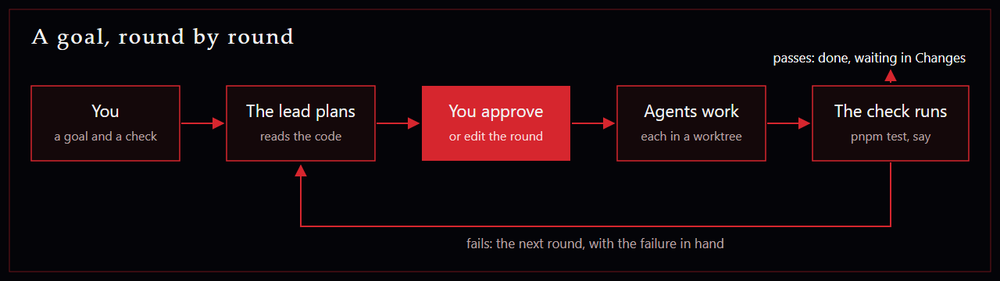
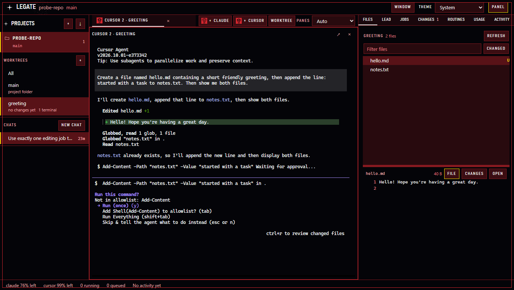

# Legate

In the Roman army a **legate** was the officer a general sent to act in his name. He was given an order, a body of soldiers and the authority to carry it out, and he reported back.

Legate does that for your coding work. You give one order. It hands the work to agents running on the AI plans you already pay for, keeps each of them in its own camp so they do not trample each other, and reports back with every step in the open.

It is a **Rust** desktop app (Tauri 2 + Dioxus) with a `legate` command line beside it. It runs the official `claude`, `codex` and Cursor `agent` tools, signed in by you, with your own plans — and can also run jobs on a **local** model through Ollama or llama.cpp.

## Why Legate

- **No API bill for cloud plans.** Legate drives the Claude Code, Codex and Cursor CLIs on the plans you already pay for, and spreads the work across them by how much allowance each has left. Coding goes to Grok first (on your Cursor plan); planning and review to Claude. Local jobs use your own GPU or CPU.
- **Nothing is a black box.** Every file an agent reads, every edit and every command appears as it happens, in the app and on the command line.
- **Agentic, with you in charge.** Give a goal and, if you like, a check such as `cargo test`. Legate plans a round, runs agents in parallel worktrees, folds their work together and runs the check, asking you before every round. Triggers start goals on a schedule, or when CI fails, an issue is opened, or your default branch breaks.

|                                 | One agent CLI on its own   | With Legate                                     |
| ------------------------------- | -------------------------- | ----------------------------------------------- |
| Plans used                      | One                        | Claude, Codex, Cursor, Grok, and local, routed by allowance |
| Several agents at once          | One terminal each, by hand | Each in its own worktree, side by side          |
| Seeing what agents do           | Scroll each terminal       | Every step of every agent in one place          |
| Keep going until the tests pass | You re-prompt              | Goals: rounds you approve, a check after each   |
| Work that starts itself         | No                         | Triggers: schedules, CI failures, new issues    |
| Review and merge                | Git by hand                | Diffs per worktree, merge with one click        |





**Status:** 0.2.0-rc.3 Rust preview for Windows x86_64. This is a prerelease of the Tauri 2 + Dioxus app. Automatic updates are disabled; install subsequent previews manually. See [docs/rust-rewrite.md](docs/rust-rewrite.md) and [docs/windows.md](docs/windows.md).

## Stack

| Layer | Choice |
| --- | --- |
| Desktop shell | Tauri 2 |
| UI | Dioxus (WASM) in the webview; terminals use xterm.js |
| Storage | SQLite via rusqlite (same schema / `%APPDATA%\Legate` as the old Electron app). Turso is behind a cargo feature; multi-process writes on Windows need rusqlite |
| Local models | `liteagent` crate + Ollama or llama-server |
| Dev loop | `bacon` |

## Install

1. **Install the Windows preview.** Download the setup executable from [GitHub Releases](https://github.com/scholtzdaniel10/agent-orchestrator/releases). The separate `legate-cli-windows-x86_64.exe` asset is the command-line app; it is not bundled into the desktop installer. To build the desktop app from this checkout:
   ```
   cargo tauri build
   ```
   The NSIS installer lands under `target/release/bundle/nsis/`. Windows warns because it is not signed: **More info** → **Run anyway**. Details: [docs/windows.md](docs/windows.md).
2. **Install Git**, which the worktrees need:
   ```
   winget install --id Git.Git -e
   ```
3. **Install and sign in to at least one plan** (or use local only):
   - Claude Code: `winget install --id Anthropic.ClaudeCode -e` then `claude auth login`
   - Codex: `npm install -g @openai/codex` then `codex login` with your ChatGPT account
   - Cursor CLI: `irm 'https://cursor.com/install?win32=true' | iex` then `agent login`
   - Local: run [Ollama](https://ollama.com) with a model (default prefs: `http://127.0.0.1:11434`, model `coder-agent`, 64K context)
4. **Optional:** GitHub CLI for clone and PRs: `winget install --id GitHub.cli -e` then `gh auth login`
5. **Open Legate.** Setup lists these tools. Data lives in `%APPDATA%\Legate` (override with `LEGATE_DATA`). An existing Electron install’s database and settings are reused.

You sign in to each cloud tool yourself. Legate never sees a password or token.

## Codex preview notes

Codex uses the official CLI's saved ChatGPT login. API-key-only authentication is not treated as a subscription provider. Usage shows only installed, signed-in providers; Codex does not expose subscription quota through this CLI, so Legate shows no invented percentage.

Background Codex jobs use native `read-only`, `workspace-write` or explicit full access. Workspace access also permits shell commands inside the sandbox. On Windows this preview selects the legacy unelevated sandbox backend because ignoring user config otherwise produced read-only jobs on the tested CLI; its network isolation is weaker than MXC. Lead jobs stay read-only and use the Legate bridge.

New interactive Codex terminals work, but automatic session restoration after restarting Legate is not yet supported. Use Codex's own resume picker when needed. Background jobs and worker takeover retain the session ID from Codex events.

## Command line

`legate` shares the same database as the desktop app.

```
legate                       open the terminal UI (also: legate ui)
legate status                each plan, and what is running here
legate plans                 same as status
legate job "<prompt>" [--type …] [--worker auto|claude|codex|cursor|grok|local] [--access read|edit|full]
legate jobs [--limit N]
legate show <job-id>
legate changes | diff | merge | discard …
legate pr "<title>" [--body "<text>"]
legate worktree create [name] | list | path <id>
legate routine list | run "<name>"
legate goal "<what should be true>" [--check "<command>"] [--rounds N] [--yes]
legate goals
```

From a checkout: `cargo run -p legate-cli -- status`. For the standalone release asset, run `legate-cli-windows-x86_64.exe status`; optionally rename it to `legate-cli.exe` and put its folder on `PATH`. The desktop executable and CLI are separate programs.

## Develop

Requires a recent stable Rust (MSVC on Windows), [WebView2](https://developer.microsoft.com/microsoft-edge/webview2/), and for UI builds: `cargo install tauri-cli --version "^2"` and `cargo install dioxus-cli`, plus `rustup target add wasm32-unknown-unknown`.

```bash
bacon                         # check on save (see bacon.toml)
cargo test --workspace
cargo clippy --workspace --all-targets -- -D warnings
cargo fmt --all --check

# desktop
cargo tauri dev               # from apps/desktop/src-tauri, or via workspace scripts
cargo tauri build             # NSIS installer

# UI only
dx serve                      # in apps/ui
dx build --release --platform web
```

| Variable         | Effect |
| ---------------- | ------ |
| `LEGATE_DATA`    | App data folder (default `%APPDATA%\Legate`) |
| `ORCH_WORKTREES` | Worktree root (default `~/.orchestrator/wt`) |
| `ORCH_CWD`       | Folder jobs run in |
| `ORCH_LEAD`      | Force lead plan: `claude`, `cursor`, … |

## Local models

Settings (or prefs JSON) include:

- `localUrl` — default `http://127.0.0.1:11434`
- `localModel` — default `coder-agent`
- `localSmallModel` — optional cascade draft model
- `localNumCtx` — default `65536`

The `local` plan is last in the router rules and has unlimited headroom. Jobs map through the `liteagent` runtime (prefix cache on llama-server, grammar tool calls, optional small→big cascade). Standalone crate: [scholtzdaniel10/liteagent](https://github.com/scholtzdaniel10/liteagent) branch `rust`.

## Security (short)

- Cloud workers are the official CLIs you signed in; Legate does not hold their tokens.
- Full access runs shell commands in a job’s worktree without asking — only in folders you trust.
- The lead’s MCP bridge listens on loopback only, with a fresh bearer token each start.
- The Files panel cannot leave the project or worktree folder.

## Why the name

A legate carried someone else's authority and answered for how he used it. The repository keeps its first name, `agent-orchestrator`.

## License

MIT
