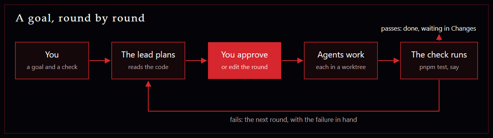
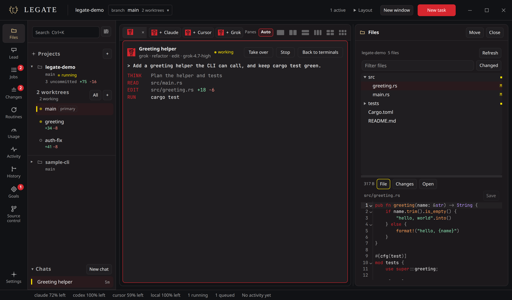

# Legate

In the Roman army a **legate** was the officer a general sent to act in his name. He was given an order, a body of soldiers and the authority to carry it out, and he reported back.

Legate does that for coding work. You give one order. It hands the work to agents running on the AI plans you already pay for, keeps each of them in its own git worktree, and reports every file read, edit, and command as it happens.

It is a **Rust** workspace: a Tauri 2 + Dioxus desktop app and a `legate` command line that share one SQLite database. Cloud work uses the official `claude`, `codex`, and Cursor `agent` CLIs you sign into yourself. Local work uses a model you already run (Ollama, llama.cpp’s `llama-server`, or another OpenAI-compatible server).

**Status:** `0.2.0-rc.5`. The desktop installer is a Windows x86_64 NSIS preview (unsigned; automatic updates are off). The CLI and library crates also build and are tested on Ubuntu. See [CHANGELOG.md](CHANGELOG.md), [docs/windows.md](docs/windows.md), and [CONTRIBUTING.md](CONTRIBUTING.md).

## Why Legate

- **No API bill for cloud plans.** Legate drives Claude Code, Codex, and the Cursor CLI on subscriptions you already pay for, and routes work by job type and remaining allowance. Coding prefers Grok (on your Cursor plan); planning and review prefer Claude. Local jobs use your own GPU or CPU.
- **Nothing is a black box.** Every file an agent reads, every edit, and every command appears as it happens, in the app and on the command line.
- **Agentic, with you in charge.** Give a goal and, if you like, a check such as `cargo test`. Legate plans a round, runs agents in parallel worktrees, folds their work together, and runs the check, asking you before every round (unless you pass `--yes`). Triggers start goals on a schedule, or when CI fails, an issue is opened, or your default branch breaks.

|                                 | One agent CLI on its own   | With Legate                                              |
| ------------------------------- | -------------------------- | -------------------------------------------------------- |
| Plans used                      | One                        | Claude, Codex, Cursor, Grok, and local, routed by allowance |
| Several agents at once          | One terminal each, by hand | Each in its own worktree, side by side                   |
| Seeing what agents do           | Scroll each terminal       | Every step of every agent in one place                   |
| Keep going until the tests pass | You re-prompt              | Goals: rounds you approve, a check after each            |
| Work that starts itself         | No                         | Triggers: schedules, CI failures, new issues             |
| Review and merge                | Git by hand                | Diffs per worktree, merge with one click                 |





## Supported providers

These are the workers in `ProviderId` (`crates/legate-core`). There are no API-key cloud backends: Legate launches the CLIs you already signed in, or a local HTTP server.

| Id       | What it runs | Auth / plan | Notes |
| -------- | ------------ | ----------- | ----- |
| `claude` | Claude Code CLI (`claude`) | `claude auth login` | Tested CLI `2.1.292`. Planning and review are first in the default router rules. |
| `codex`  | Official Codex CLI (`codex`) | `codex login` with a **ChatGPT** account | Tested CLI `0.167.0-alpha.3.2`. API-key-only auth is not treated as a subscription: `OPENAI_API_KEY` and `CODEX_API_KEY` are stripped from the process environment. Codex does not expose subscription quota through this CLI, so Legate does not invent a percentage. |
| `cursor` | Cursor CLI (`agent`) | `agent login` | Tested CLI `2026.10.01-e373342`. |
| `grok`   | The same Cursor CLI, on a Grok model | Spends the **Cursor** plan | Default model `grok-4.7-high` when none is set. Coding jobs (debugging, refactor, boilerplate) prefer Grok in the default rules. |
| `local`  | HTTP model via the in-tree `liteagent` crate | None (your server) | Auto-detects Ollama (`/api/version`), llama.cpp `llama-server` (`/props` or `/health`), or any server that answers `/v1/models` (OpenAI-compatible `/v1/chat/completions`). Unlimited router headroom; last in every default rule list. |

At least one of Git plus a signed-in cloud CLI, or a local server, is enough to run jobs. GitHub CLI (`gh`) is optional (clone and pull requests).

## Architecture

```
Cargo.toml                 workspace (edition 2024, version 0.2.0-rc.5)
crates/legate-core         types, settings, paths, ids, router rules (no tokio; builds for wasm32)
crates/legate-store        SQLite via rusqlite (bundled). `turso` is an optional cargo feature, not the default
crates/legate-router       job router and orchestrator (allowance, pace, worktrees, memory guard)
crates/legate-providers    claude, codex, cursor/grok, local adapters
crates/liteagent           local agent loop: prefix cache, tool grammar, cascade, loop guard
crates/legate-pty          interactive PTY sessions
crates/legate-git          worktrees, diffs, history, files, GitHub
crates/legate-lead         lead chat, goals, routines, triggers, plugins, setup
crates/legate-bridge       localhost MCP bridge (JSON-RPC on 127.0.0.1, fresh bearer token each start)
crates/legate-app          main-process service shared by the desktop app and CLI
crates/legate-cli          `legate` binary (clap + ratatui TUI)
apps/ui                    Dioxus 0.7 UI, compiled to WASM
apps/desktop/src-tauri     Tauri 2 shell (`legate-desktop`)
resources/plugins          bundled agent skills (delegate, review, worktree, CLI)
```

The desktop app and the CLI share `orchestrator.sqlite` and `settings.json` in the data folder. The orchestrator runs on one thread (`tokio::task::LocalSet`); the MCP bridge, terminals, and git commands use the multi-thread runtime around it.

Default router order (from `crates/legate-core/rules.json`):

| Job type     | Preference order |
| ------------ | ---------------- |
| planning     | claude, codex, cursor, grok, local |
| review       | claude, codex, cursor, grok, local |
| debugging    | grok, cursor, codex, claude, local |
| refactor     | grok, cursor, codex, claude, local |
| boilerplate  | grok, cursor, codex, claude, local |

A missing, signed-out, switched-off, or resting plan is skipped for the next available one.

## Prerequisites

- **Rust:** stable toolchain with the 2024 edition (**1.85 or later**). CI installs current stable (`dtolnay/rust-toolchain@stable`).
- **Git:** required for worktrees.
- **Desktop (Windows):** [WebView2](https://developer.microsoft.com/microsoft-edge/webview2/), MSVC toolchain, `wasm32-unknown-unknown`, [tauri-cli](https://crates.io/crates/tauri-cli) 2.x, and [dioxus-cli](https://crates.io/crates/dioxus-cli) **0.7.10** (the version CI pins).
- **Optional tools:** Claude Code, Codex, Cursor CLI, GitHub CLI, [Ollama](https://ollama.com) or llama-server, `bacon` for the save-on-check loop.

`rusqlite` is built with the `bundled` feature, so you do not need a system SQLite.

## Install

### From this checkout

CLI (Linux, macOS, or Windows):

```bash
cargo build -p legate-cli --release --locked
# binary: target/release/legate
```

Desktop installer (Windows; from the repository root after the UI toolchain is installed):

```bash
cd apps/desktop/src-tauri
cargo tauri build
```

The NSIS installer lands under `target/release/bundle/nsis/`. Windows SmartScreen warns because it is not signed: **More info** → **Run anyway**. Details: [docs/windows.md](docs/windows.md).

`.github/workflows/release.yml` also builds a standalone `legate-cli-windows-x86_64.exe` and the NSIS installer when a `v*.*.*` tag is pushed. Automatic updates in the installed app are compiled off (`UPDATER_ENABLED` is false).

The GitHub “latest” release named **0.1.0** is the previous Electron app, not this tree. Build from this checkout (or a matching `0.2.0-rc.*` tag) for the Rust app.

### Plan CLIs (or local only)

Git, then at least one worker:

| Tool | Windows | macOS / Linux | Sign in |
| ---- | ------- | ------------- | ------- |
| Git | `winget install --id Git.Git -e` | macOS: `xcode-select --install`; Debian/Ubuntu: `sudo apt install git` | — |
| Claude Code | `winget install --id Anthropic.ClaudeCode -e` | `npm install -g @anthropic-ai/claude-code` | `claude auth login` |
| Codex | `npm install -g @openai/codex` | same | `codex login` (ChatGPT account) |
| Cursor CLI | `irm 'https://cursor.com/install?win32=true' \| iex` | `curl https://cursor.com/install -fsS \| bash` | `agent login` |
| GitHub CLI (optional) | `winget install --id GitHub.cli -e` | macOS: `brew install gh`; Debian/Ubuntu: `sudo apt install gh` | `gh auth login` |
| Local | Run [Ollama](https://ollama.com) or llama-server | same | none |

You sign in to each cloud tool yourself. Legate never sees a password or token. Setup in the desktop app lists these tools and their install commands.

## Configuration

### Data folder

Override with `LEGATE_DATA`. Otherwise:

| Platform | Default |
| -------- | ------- |
| Windows | `%APPDATA%\Legate` |
| macOS | `~/Library/Application Support/Legate` |
| Linux | `$XDG_CONFIG_HOME/Legate` or `~/.config/Legate` |

Files there:

- `settings.json` — project list, per-plan models, lead plan/access, skill folders, prefs
- `orchestrator.sqlite` — jobs, goals, chats, usage, worktrees
- `lead/` — saved lead chats

The desktop app and `legate` share this folder.

### Environment

| Variable | Effect |
| -------- | ------ |
| `LEGATE_DATA` | Data folder (database + settings) |
| `ORCH_WORKTREES` | Worktree root (default `~/.orchestrator/wt`) |
| `ORCH_CWD` | Folder jobs run in when the app does not already have a project |
| `ORCH_LEAD` | Force the lead plan: `claude`, `codex`, `cursor`, `grok`, or `local` |
| `ORCH_RULES` | Path to a router-rules JSON file (otherwise the embedded `rules.json`) |

### `settings.json`

Top-level fields the app reads and writes:

| Field | Meaning |
| ----- | ------- |
| `project` / `projects` | Active project path and the project list |
| `models` | Per-provider model id (`claude`, `codex`, `cursor`, `grok`, `local`) |
| `leadModels` | Optional lead-only model, separate from the worker model |
| `lead` | Lead plan id |
| `leadAccess` | `read`, `edit`, or `full` |
| `skillFolders` | Extra skill directories loaded only into agents Legate starts |
| `prefs` | See below |

`prefs` keys (camelCase, matching the Settings page):

| Key | Default | Meaning |
| --- | ------- | ------- |
| `maxParallel` | rules file (`3`) | Jobs one plan may run at once (`1`–`8`) |
| `terminalFontSize` | `13` | Terminal text size (`10`–`22`) |
| `notify` | `true` | Desktop notification when a job ends while no window is focused |
| `cloneDir` | unset | Folder for GitHub clones |
| `uiScale` | `90` | UI scale percent: `80`, `90`, `100`, `110`, or `120` |
| `usageShows` | `left` | Usage meter: `left` or `used` |
| `leadMode` | `manual` | `manual`, `auto`, or `legit` (LEG IT!) |
| `cursorModels` | `own` | Cursor model picker: `own` or `all` |
| `usageCheck` | `true` | Poll live usage |
| `offPlans` | `[]` | Plan ids that must not be checked or routed |
| `localUrl` | `http://127.0.0.1:11434` | Local model server |
| `localModel` | `coder-agent` | Model name (Ollama / OpenAI-compatible; llama-server ignores it) |
| `localSmallModel` | unset | Optional cascade draft model |
| `localNumCtx` | `65536` | Ollama `num_ctx` (`4096`–`262144`) |

## Command line

`legate` is the `legate-cli` binary. It uses the same database as the desktop app.

```
legate [--project <path>] <command>
legate                       open the terminal UI (also: legate ui)
legate status                each plan, and what is running here
legate plans                 same as status
legate job "<prompt>" [--type planning|debugging|review|refactor|boilerplate]
                            [--worker auto|claude|codex|cursor|grok|local]
                            [--access read|edit|full] [--json] [--quiet] [--verbose]
legate jobs [--limit N]
legate search "<text>" [--limit N] [--json]
legate show <job-id>
legate changes
legate diff <change-id>
legate merge <change-id>
legate discard <change-id> [--yes]
legate pr "<title>" [--body "<text>"]
legate worktree create [name]
legate worktree list
legate worktree path <change-id-or-name>
legate routine list
legate routine run "<name>" [--json] [--quiet] [--verbose]
legate goal "<what should be true>" [--check "<command>"] [--rounds N] [--yes]
legate goals
```

From a checkout:

```bash
cargo run -p legate-cli -- --help
cargo run -p legate-cli -- status
cargo run -p legate-cli -- job "summarize the router" --type review --access read
cargo run -p legate-cli -- goal "cargo test passes" --check "cargo test --workspace --exclude legate-desktop --locked"
```

`--project` selects the git top-level (or the given folder). `legate search` matches words in saved chats and jobs (default limit 30).

## Local models

Point `prefs.localUrl` at the server. `Backend::connect` in `liteagent` probes the URL:

1. Ollama if `/api/version` answers
2. llama-server if `/props` or `/health` answers
3. OpenAI-compatible if `/v1/models` answers

On llama-server, the system prompt and tool list can be saved and restored as a slot prefix (`--slot-save-path`). Ollama has no slot files; the message list is still append-only so Ollama’s own prompt cache can hit. A small model, when set, tries each step and hands hard or invalid steps to the big model.

Local jobs always start a fresh conversation (`resume` is ignored). Shell commands from a local job run in the work folder (`powershell` on Windows, `sh` elsewhere), time out after 60 seconds, and are truncated at 8,000 characters. File writes are jailed to that folder.

Standalone crate notes and a bench binary: [crates/liteagent/README.md](crates/liteagent/README.md).

```bash
cargo test -p liteagent --locked
cargo run -p liteagent --bin liteagent-bench -- --help
```

## Develop

```bash
bacon                         # check on save (see bacon.toml)
cargo test --workspace --exclude legate-desktop --locked
cargo clippy --workspace --exclude legate-desktop --all-targets --locked -- -D warnings
cargo fmt --all --check

# desktop (Windows; in apps/desktop/src-tauri)
# first: cargo install tauri-cli --version "^2" --locked
#        cargo install dioxus-cli --version 0.7.10 --locked
#        rustup target add wasm32-unknown-unknown
cargo tauri dev
cargo tauri build             # NSIS installer

# UI only
cd apps/ui
dx serve                      # Dioxus dev server (Tauri uses port 8080)
dx build --release --platform web

# desktop checks (from the repository root, after building UI assets above)
cargo clippy -p legate-desktop --all-targets --locked -- -D warnings
cargo test -p legate-desktop --locked
```

CI (`.github/workflows/rust.yml`) runs format, clippy, and tests on Windows and Ubuntu, wasm browser smokes on Ubuntu, and the desktop crate on Windows after `dx build`. A separate [click-through](.github/workflows/clickthrough.yml) workflow drives the real Windows app.

The UI’s screens only compile for wasm, so `cargo test --workspace` never runs them. Browser smokes:

```bash
cargo install wasm-bindgen-cli --version 0.2.130 --locked   # match wasm-bindgen in Cargo.lock
# needs CHROMEDRIVER, GECKODRIVER, or MSEDGEDRIVER on PATH
cargo test -p legate-ui --target wasm32-unknown-unknown --test app_smoke --test setup_smoke --locked
```

## Codex notes

Background Codex jobs use native `read-only`, `workspace-write`, or explicit full access. Workspace-write also permits shell commands inside the sandbox. On Windows the preview selects the legacy unelevated sandbox backend because ignoring user config otherwise produced read-only jobs on the tested CLI; its network isolation is weaker than MXC. Lead jobs stay read-only unless Auto/LEG IT! raises access, and they use the Legate MCP bridge.

New interactive Codex terminals work. Automatic session restoration after restarting Legate is not supported; use Codex’s own resume picker when needed. Background jobs and worker takeover retain the session ID from Codex events.

## Security (short)

- Cloud workers are the official CLIs you signed in; Legate does not hold their tokens.
- Full access runs shell commands in a job’s worktree without asking — only in folders you trust.
- **Auto** and **LEG IT!** start the lead’s plans without Run. LEG IT! gives editing jobs full access, lets the lead edit the project and run commands, and opens Claude and Cursor terminals with `bypassPermissions` and `--force`, respectively. The first switch to LEG IT! in each window asks for confirmation.
- On Windows and Linux, Legate starts jobs one at a time when enough memory is available and stops the newest running job if free memory drops critically low. The desktop app and the `legate` command both use this guard.
- The lead’s MCP bridge listens on loopback only, with a fresh bearer token each start.
- The Files panel cannot leave the project or worktree folder.

## Why the name

A legate carried someone else’s authority and answered for how he used it. The repository keeps its first name, `agent-orchestrator`.

## Contributing

See [CONTRIBUTING.md](CONTRIBUTING.md). Before a PR:

```bash
cargo fmt --all --check
cargo clippy --workspace --exclude legate-desktop --all-targets --locked -- -D warnings
cargo test --workspace --exclude legate-desktop --locked
```

## License

MIT
