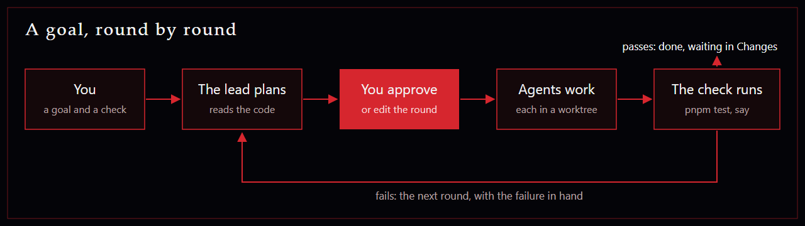
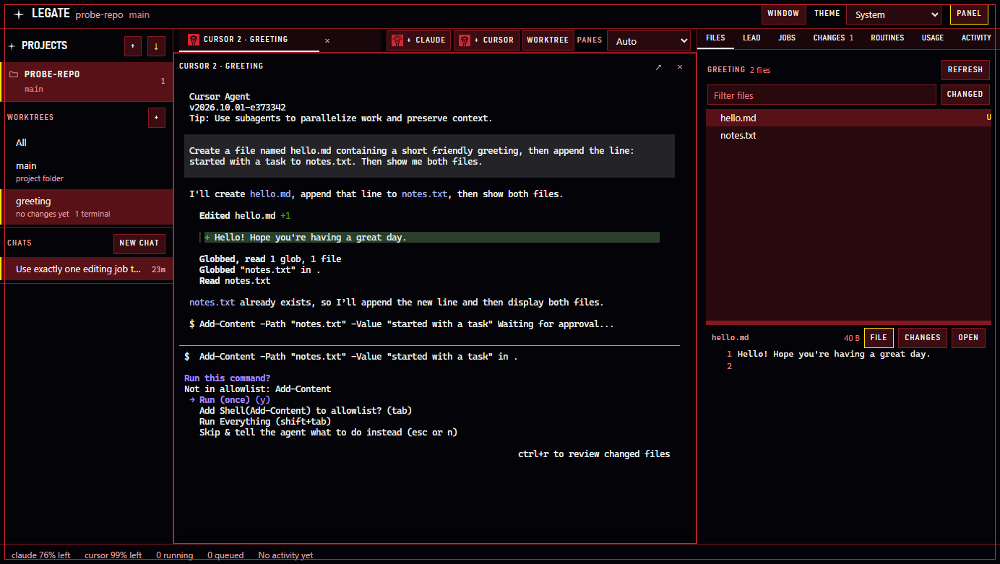
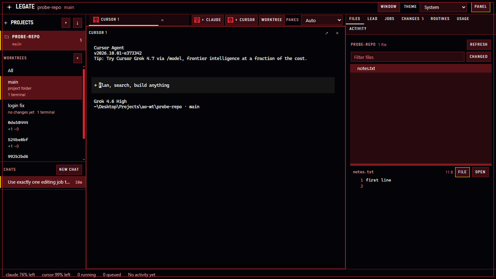

# Legate

In the Roman army a **legate** was the officer a general sent to act in his name. He was given an order, a body of soldiers and the authority to carry it out, and he reported back.

Legate does that for your coding work. You give one order. It hands the work to agents running on the AI plans you already pay for, keeps each of them in its own camp so they do not trample each other, and reports back with every step in the open.

It is a desktop app (Electron + TypeScript) with a terminal UI and a command line beside it. It runs the official `claude` and Cursor `agent` tools, signed in by you, with your own plans.

## Why Legate

- **No API bill.** Legate drives the Claude Code and Cursor CLIs on the plans you already pay for, and spreads the work across them by how much allowance each has left. Coding goes to Cursor first; planning and review to Claude.
- **Nothing is a black box.** Every file an agent reads, every edit and every command appears as it happens, in the app, the terminal UI and the command line.
- **Agentic, with you in charge.** Give a goal and, if you like, a check such as `pnpm test`. Legate plans a round, runs agents in parallel worktrees, folds their work together and runs the check, asking you before every round. Triggers start goals on a schedule, or when CI fails, an issue is opened, or your default branch breaks.

|                                 | One agent CLI on its own   | With Legate                                     |
| ------------------------------- | -------------------------- | ----------------------------------------------- |
| Plans used                      | One                        | Claude and Cursor together, routed by allowance |
| Several agents at once          | One terminal each, by hand | Each in its own worktree, side by side          |
| Seeing what agents do           | Scroll each terminal       | Every step of every agent in one place          |
| Keep going until the tests pass | You re-prompt              | Goals: rounds you approve, a check after each   |
| Work that starts itself         | No                         | Triggers: schedules, CI failures, new issues    |
| Review and merge                | Git by hand                | Diffs per worktree, merge with one click        |





**Status:** 1.6, Windows. Unit-tested throughout (570 tests) and checked against the real tools: jobs at all three access levels on both plans, the lead handing out work, goals end to end (also from `legate goal`), triggers, worktrees, terminals restored after a restart, the command line and the app sharing jobs, the terminal UI, and auto-update. Not yet checked: the installer on a clean machine, macOS and Linux. See [BACKLOG.md](BACKLOG.md).

## The chain of command

| In Rome         | In Legate   | What it is                                                             |
| --------------- | ----------- | ---------------------------------------------------------------------- |
| The general     | You         | Gives the order, reviews the result, decides what is kept              |
| The legate      | The lead    | One agent you talk to. It splits your order into jobs and reports back |
| The cohorts     | The workers | Agents on your Claude and Cursor plans that do the jobs                |
| The camp        | A worktree  | A separate copy of the project for one task, so work never collides    |
| The dispatch    | The steps   | Every file read, every edit, every command, listed as it happens       |
| Standing orders | Routines    | Saved jobs, and commands that prepare each new camp                    |

## How it works

- **The window is a workspace.** The sidebar has a project switcher, **New task** (`Ctrl+N`), Goals, Automations, and your worktrees as cards grouped by state: in progress, needs you, ready to review. Agent terminals fill the centre, and a panel on the right opens on the files of the worktree you are in. The same panel holds the lead, jobs, changes, routines, usage, activity, the commit history with its branch graph, and goals (`Ctrl+1` to `Ctrl+9`; `Ctrl+B` hides it). Drag any tab above or below the terminals, under the projects, or out into a window of its own. A status bar shows each plan's allowance and what is running.
- **The lead.** You talk to one lead. It splits your request into jobs, hands them to workers, and reports back when they finish; you can keep talking while they run. The lead is an ordinary CLI session that can only call the app's own four tools. You set the most it may hand out: read only, edit files, or full access.
- **Workers and access.** You can also hand a job straight to a worker and pick its type and its access. _Read only_ reads files and answers. _Edit files_ edits inside its own worktree. _Full access_ also runs commands without asking, still inside its own worktree. Each plan runs up to three jobs at once, and a job can be stopped.
- **Steps.** Nothing is a black box. Every file a worker reads or edits and every command it runs is listed live under its job, with an "Edited N files" summary whose rows open to that file's diff.
- **Worktrees.** Any job or terminal that may change files works in its own git worktree. Create one from the sidebar with a name and a **task**, and the agent in it starts working at once; ask for several and you get several agents on the same task. Select one or many to see their terminals together.
- **Terminals.** A terminal is a full Claude or Cursor session you talk to directly, shown in a grid of up to six panes. A terminal can move into a window of its own, and open terminals come back after a restart with their conversation.
- **Files.** The panel shows the files of the selected project or worktree, marks what changed, and previews a file or its diff. It reads and opens files; it never writes them.
- **Changes.** Pick a worktree and open **Review** beside its terminals, or use the Changes tab. You read its diff, then merge it as staged changes, discard it, or open a pull request through `gh`. A worktree cannot be merged or discarded while a job is still running in it.
- **Routines and setup.** A routine is a saved job you run with one click, or after every job of a kind you choose. Setup commands (for example `pnpm install`) run in each worktree you create by hand, in a terminal you can watch.
- **Goals.** Say what should be true, and optionally a check such as `pnpm test`. The lead proposes each round of jobs and waits for your OK; changes collect in one worktree, the check runs after every round, and it stops when the check passes, at the round limit, or when the same failure repeats. A job with a check is a small goal: it fixes until the check passes. Triggers start goals on a schedule, or when CI fails on your pull request, an issue is opened, or the default branch breaks.
- **Skills.** Every agent Legate starts gets Legate's own skills: worktree rules and a read-only `legate` CLI for workers, how to delegate for the lead, and how to review a change for both. Add your own skill folders in Settings → Skills. They load only into Legate's agents, never into your other Claude or Cursor sessions.
- **The router.** A rule table and how much allowance each plan has left decide who gets a job. Coding work goes to Cursor first; planning and review go to Claude. If a plan reports its limit, it rests and its queued jobs move to the other plan.
- **Compare.** Send the same prompt to both plans, read the results side by side, keep one.
- **Windows and looks.** Open up to six windows of the same app. Seven looks are chosen in Settings → General.

Everything runs locally, per person. There is no server and no account.



## Install

1. **Install Legate.** Download `legate-<version>-setup.exe` from [GitHub Releases](https://github.com/scholtzdaniel10/agent-orchestrator/releases) and run it. Windows warns because the installer is not signed: choose **More info**, then **Run anyway**. Updates download in the background and install when you quit.
2. **Install Git**, which the worktrees need:
   ```
   winget install --id Git.Git -e
   ```
3. **Install and sign in to at least one plan.** Either is enough; both is better.
   - Claude Code (needs a Claude Pro or Max plan):
     ```
     winget install --id Anthropic.ClaudeCode -e
     claude auth login
     ```
   - Cursor CLI (needs a Cursor plan), in PowerShell:
     ```
     irm 'https://cursor.com/install?win32=true' | iex
     agent login
     ```
4. **Optional: the GitHub CLI**, to clone your repositories and open pull requests:
   ```
   winget install --id GitHub.cli -e
   gh auth login
   ```
5. **Open Legate.** On first start it opens **Setup**, which lists these tools, shows what each still needs, gives the install command, and runs each tool's own sign-in in a terminal on the screen. So steps 2 to 4 can also be done from there. Then add a project folder.

You sign in to each tool yourself, in that tool's own sign-in. Legate never sees a password or a token.

## Command line

`legate` drives the same jobs, changes and routines from a terminal. The app and the command share one database, and each sees the other's jobs within a few seconds.

With no arguments, `legate` opens a terminal UI: worktrees and jobs on the left, the selected job's live steps or a worktree's diff on the right, and a prompt line to hand out a job. `?` lists the keys.

```
legate                       open the terminal UI (also: legate ui)
legate status                each plan, and what is running here
legate job "<prompt>" [--type planning|debugging|review|refactor|boilerplate]
                      [--worker auto|claude|cursor] [--access read|edit|full] [--json] [--quiet]
legate jobs [--limit N]      recent jobs
legate show <job-id>         one job with every step
legate changes               worktrees and their changes
legate diff <change-id>
legate merge <change-id>
legate discard <change-id>
legate pr "<title>" [--body "<text>"]
legate worktree create [name] | list | path <change-id-or-name>
legate routine list | run "<name>"
legate goal "<what should be true>" [--check "<command>"] [--rounds N] [--yes]
legate goals                 goals in this project
```

In a checkout, run `pnpm cli -- status`. In an installed copy, add the app's `resources\bin` folder to PATH.

## Subscription use

- Legate runs the unmodified official CLIs, each signed in by you with your own plan.
- It never reads, stores or forwards login tokens or session credentials.
- It does not use any Agent SDK and makes no pay-per-token API calls.
- Jobs are started by a person. A routine runs only after something you did, never on a timer.

You are responsible for staying within each provider's terms.

## Security

- Everyone uses their own plans. The app has no accounts, no server and no way to reach anyone else's login.
- Every window is made by one function with the same sandbox: it cannot navigate away from the app, cannot open other pages, is refused every permission, and reaches the main process only through a fixed list of functions.
- A worker's limits are set when it starts, whatever your own CLI settings allow:
  - Claude workers get no shell and no edit tools when reading, no shell when editing, and never your own MCP servers, not even with full access.
  - Cursor workers are started without `--force` unless the job has full access, and an editing job gets a permission file that denies the shell. Rules in your own Cursor CLI config, or a `.cursor/cli.json` in the project, still apply.
- Full access runs commands on your computer without asking. Use it only in folders you trust.
- The lead reaches the app through a small local server with four tools (`list_workers`, `send_job`, `get_status`, `get_result`). It listens on loopback only, requires a random token that changes every start, and refuses requests that carry a browser `Origin`.
- The Files panel can only read inside the project or worktree folder; a path that leads outside it is refused.
- Only add or clone folders you trust. A project can carry its own Claude Code or Cursor settings, including hooks that run commands when an agent works there.
- The terminals are full CLI sessions; what they may do is whatever you approve inside them.

## Develop

Requires Node 22.5 or newer and pnpm.

```bash
pnpm install
pnpm dev              # run the app
pnpm test             # unit tests, no real CLIs
pnpm build            # typecheck + build (also builds the legate command)
pnpm shots            # screenshots of the UI with fake data, in .orchestrator/shots/
pnpm cli -- status    # the legate command from this checkout
pnpm build:win        # the Windows installer, in dist/
pnpm gate router      # acceptance: 10 real jobs + one forced failover
pnpm gate lead        # acceptance: the lead splits a two-part request across both plans
pnpm gate worktrees   # acceptance: an editing job merges cleanly (GATE_WORKERS=cursor for one plan)
```

The `gate` commands use your real plans and spend real allowance.

| Variable         | Effect                                                                               |
| ---------------- | ------------------------------------------------------------------------------------ |
| `ORCH_CWD`       | Folder the jobs run in (default: where the app was started)                          |
| `ORCH_RULES`     | Path to your own edited copy of `src/core/router/rules.json`                         |
| `ORCH_LEAD`      | `claude` or `cursor` to choose the lead's plan (default: the one with more headroom) |
| `ORCH_WORKTREES` | Folder the worktrees are made in (default: `~/.orchestrator/wt`)                     |
| `ORCH_NO_UPDATE` | `1` stops an installed build from checking GitHub Releases for updates               |
| `LEGATE_DATA`    | Data folder for the `legate` command (default: the app's own)                        |

Everything in `src/core` runs without Electron; the app, the command and the terminal UI are three ways into the same core. Data is stored locally with Node's built-in `node:sqlite`, so there is no native database module to rebuild.

### Release

Bump `"version"` in `package.json`, tag `vX.Y.Z`, and push the tag. That builds a draft GitHub Release with the Windows installer; publish the draft when you are ready.

## Tested with

- Claude Code `2.1.292`
- Cursor CLI `2026.10.01-e373342`

Newer CLI versions usually work. Each plan shows its CLI version against the tested one, and a job fails with a readable message when a CLI sends output the app does not understand.

## Why the name

A legate carried someone else's authority and answered for how he used it. That is the deal here: the agents act for you, inside limits you set, and the record of what they did is yours to read. The repository keeps its first name, `agent-orchestrator`.

## License

MIT
